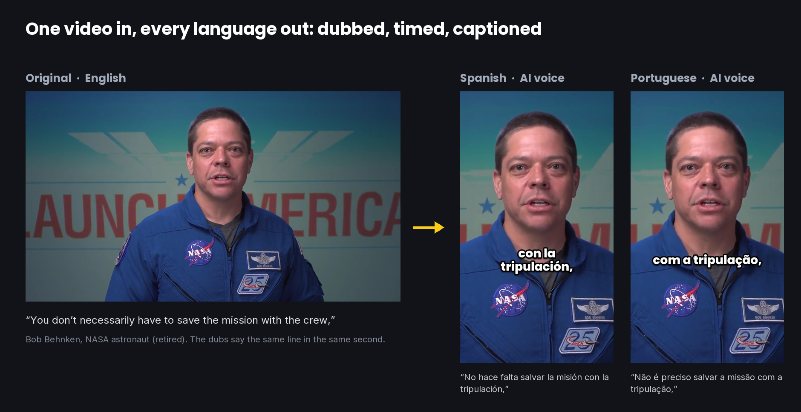
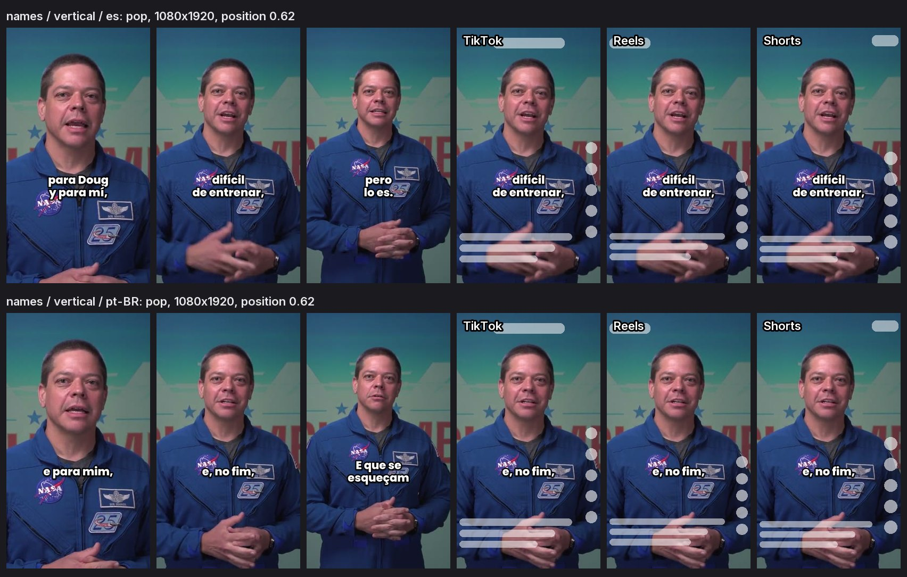

# AI Dubbing Skill for Claude Code, Codex, Cursor and OpenClaw

**AI Dubbing Skill** is a free, open-source AI dubbing skill for Claude Code and other AI agents. Your agent dubs your videos into other languages on your own computer: it transcribes the speech, proofreads names and numbers, translates every line for the ear, speaks it with a free AI voice (or your own ElevenLabs voice), fits each line to the time the speaker took, mixes it over the original sound, burns in captions in the same words, and, if you want, posts or schedules the dubbed videos through [WoopSocial](https://woopsocial.com/?utm_source=ai-dubbing-skill&utm_medium=readme) after you say yes:

- free voices that run on your computer: Kokoro for Spanish, French, Italian, Brazilian Portuguese, Hindi and English, and Piper for German, Dutch, Polish, Russian, Ukrainian, Swedish and 9 more languages, all with licences that allow commercial use;
- your own ElevenLabs key for any other language, or for your own cloned voice;
- translations written to be spoken, as long in time as the original, so the dub stays in sync without chipmunk speed-ups;
- every line timed to its slot, sped up at most 1.15x, and a list of any line that must be shorter, so nothing runs over the next sentence;
- the original sound kept quietly underneath, the music kept and the voice removed (with demucs), or the dub on its own;
- captions in the dubbed language that say exactly what the voice says, in 8 creator styles, plus SRT and VTT files;
- 9:16, 4:5, 1:1 or 16:9 from any video, with a review sheet showing TikTok's, Reels' and Shorts' buttons;
- every dubbed post marked as AI-generated where the platform asks for it;
- whole folders and many languages at once; only changed lines are spoken again.

No watermark, no per-minute fee, no account needed for the free voices. Python, numpy, Pillow and ffmpeg. MIT licensed.

```bash
npx skills add social-media-skills/ai-dubbing-skill -g -a claude-code -y
```

**Post it from your agent:** to have your agent schedule each language's version to its own TikTok, Instagram, YouTube and other accounts, [make a free WoopSocial account](https://app.woopsocial.com/signup?utm_source=ai-dubbing-skill&utm_medium=readme&utm_content=top) (free for 2 social accounts, no card).



*From the example in [`examples/crew-dragon/`](skills/ai-dubbing-skill/examples/crew-dragon/): two clips of retired NASA astronaut Bob Behnken, dubbed into Spanish and Brazilian Portuguese for TikTok, Reels and Shorts with the free voices. Every file in it was made by the skill's scripts. The voices are stock AI voices, not his. See [CREDITS](skills/ai-dubbing-skill/examples/crew-dragon/CREDITS.md).*

## Contents

- [What the AI dubbing skill does](#what-the-ai-dubbing-skill-does)
- [Requirements](#requirements)
- [Install](#install)
- [Example: dub a video into Spanish with Claude Code](#example-dub-a-video-into-spanish-with-claude-code)
- [Voices](#voices)
- [Keeping the dub in sync](#keeping-the-dub-in-sync)
- [Background sound](#background-sound)
- [Posting the dubbed videos](#posting-the-dubbed-videos)
- [FAQ](#faq)
- [What's inside](#whats-inside)

## What the AI dubbing skill does

Tell your agent "dub this video into Spanish", "make German and French versions of every clip in this folder for Reels" or "dub my video into Japanese in my own voice", and it does the whole job:

1. **Asks** which languages, where the videos will go, which names must be spelled right, and which voice.
2. **Transcribes** with `transcribe.py`: every word with its time.
3. **Proofreads** with `fix.py`: names, numbers and punctuation, because the voice phrases each sentence by its punctuation.
4. **Translates** each subtitle cue in a template that keeps the original timing, for the ear and the clock: natural spoken words, no longer than the speaker took.
5. **Lets you pick a voice** with `voices.py sample`: every free voice says your first line.
6. **Dubs** with `dub.py`: speaks each line, fits it to its slot, mixes it over the original, and lists any line that must be shorter.
7. **Shows a review sheet** with `render.py --preview`, then **renders** every video in every shape and language, with the dubbed sound and matching captions.
8. **Plans the posts** if you want: `post_plan.py` gives each language its own accounts, marks the posts as AI-generated, schedules one a day per account, and posts through WoopSocial after one clear yes.

## Requirements

- Python 3.9 or newer with Pillow and numpy (`pip install pillow numpy`); on Windows also `pip install tzdata` for scheduling.
- ffmpeg (any build).
- A voice: `pip install kokoro-onnx soundfile` and/or `pip install piper-tts` (free, on your computer; each voice downloads once), or an `ELEVENLABS_API_KEY`.
- One way to transcribe: `pip install faster-whisper` (free, runs locally), `pip install mlx-whisper` on Apple Silicon, a `GROQ_API_KEY` or `DEEPGRAM_API_KEY`, or the video's own .srt/.vtt.
- Optional: `pip install demucs` to keep the music and remove the original voice.
- An agent that can run commands on your computer (Claude Code, Codex, Cursor, OpenClaw or similar).

`python3 scripts/check_setup.py` tells you what's missing and the install command for your system. A CI workflow runs the full pipeline on macOS, Windows and Ubuntu, and a real dub with the free voices that Whisper then listens back to.

## Install

**Claude Code**

```bash
npx skills add social-media-skills/ai-dubbing-skill -g -a claude-code -y
```

**Codex, Cursor and other agents:** run `npx skills add social-media-skills/ai-dubbing-skill` and pick your agent, or copy `skills/ai-dubbing-skill/` into your agent's skills directory.

**OpenClaw (ClawHub):** `openclaw skills install @social-media-skills/ai-dubbing-skill`

**GitHub CLI:** `gh skill install social-media-skills/ai-dubbing-skill ai-dubbing-skill`

**Gemini CLI:** `gemini extensions install https://github.com/social-media-skills/ai-dubbing-skill`

## Example: dub a video into Spanish with Claude Code

> Dub clips/names.mp4 and clips/crew.mp4 into Spanish and Brazilian Portuguese for TikTok, Reels and Shorts. The speaker is Bob Behnken.

The agent writes a job file:

```json
{
  "videos": [{"file": "clips/names.mp4", "id": "names"}, {"file": "clips/crew.mp4", "id": "crew"}],
  "language": "en",
  "vocab": ["Bob Behnken", "Doug", "Dragon", "SpaceX", "NASA", "space station"],
  "translations": ["es", "pt-BR"],
  "voices": {"es": "kokoro:em_alex", "pt-BR": "kokoro:pm_alex"},
  "dub": {"background": "voiceover"},
  "outputs": [
    {"id": "vertical", "style": "pop", "canvas": "9:16", "fit": "crop", "focus_x": 0.52, "languages": ["es", "pt-BR"]}
  ]
}
```

Then it runs:

```bash
python3 <skill>/scripts/transcribe.py dub.json
python3 <skill>/scripts/fix.py dub.json --report     # what to check
# the agent reads work/<id>/transcript.txt and writes work/<id>/fixes.json
python3 <skill>/scripts/captions.py dub.json         # subtitle files and translation templates
# the agent fills work/<id>/translate.es.json and translate.pt-BR.json
python3 <skill>/scripts/voices.py sample dub.json es # hear the free Spanish voices
python3 <skill>/scripts/dub.py dub.json              # the dubbed soundtracks
python3 <skill>/scripts/render.py dub.json --preview
python3 <skill>/scripts/render.py dub.json           # four dubbed videos
```

Every line fit its slot between 0.9x and 1.0x speed, so no line had to be shortened. The review sheet shows each version with the dubbed captions and each app's buttons drawn on:



## Voices

| Voice | Cost | Languages | What it sends |
|---|---|---|---|
| Kokoro (`kokoro-onnx`) | free | Spanish, French, Italian, Brazilian Portuguese, Hindi, English | nothing: runs on your computer |
| Piper (`piper-tts`) | free | German, Dutch, Polish, Russian, Ukrainian, Czech, Danish, Finnish, Hungarian, Romanian, Greek, Persian, Norwegian, Swedish, Vietnamese | nothing: runs on your computer |
| ElevenLabs (your key) | your credits | every language ElevenLabs speaks, and your own cloned voice | the translated text |

`python3 scripts/voices.py list` shows every voice and its licence. Only voices whose licence allows commercial use are included. With ElevenLabs, `dub.py` counts the characters and stops until you confirm the cost, and a rerun only pays for lines that changed. A cloned voice is only ever your own, or one whose speaker gave written consent.

## Keeping the dub in sync

Spanish, Portuguese, French and German usually run 15 to 30% longer than English, which is why a word-for-word dub sounds rushed. The skill handles this in three places:

- the agent translates for the clock: the same meaning in fewer words, spoken filler dropped;
- `dub.py` slows a line that finishes early (down to 0.9x) and speeds up one that runs long (up to 1.15x, or `max_speed`), using the voice engine's own speed setting, so the voice keeps its pitch;
- any line that still doesn't fit is listed with how much shorter it must be, and the agent rewrites only that line.

The captions are made from the same text, so what you hear and what you read always match. There is no lip sync: the voice follows the speaker's timing, not their mouth.

## Background sound

| `dub.background` | What you hear | Needs |
|---|---|---|
| `voiceover` (default) | the dub, with the original sound quietly underneath while the voice speaks | nothing extra |
| `separate` | the dub over the original music and sound, with the original voice removed | `pip install demucs`; slower (about half a minute for a short clip on a laptop) |
| `none` | the dub on its own | nothing extra |

## Posting the dubbed videos

Tell the agent which accounts post which language, and it writes the post texts and a schedule after the dubs are done. The plan works without connecting anything: `plan.md` lists every file, post text and time, so you can post by hand. `post_plan.py` checks every file against each platform, gives each account its own language, schedules at most one post a day per account, marks every dubbed post as AI-generated on TikTok and Instagram, and lists the "Altered or synthetic content" answer to give in YouTube Studio. The agent uploads each file once, validates every request, shows you the plan and waits for one clear yes before anything is scheduled.

Posting runs through [WoopSocial's MCP for AI agents](https://woopsocial.com/agents?utm_source=ai-dubbing-skill&utm_medium=readme), made by the team that maintains this skill. It posts to TikTok, Instagram, YouTube, Facebook, LinkedIn, X, Threads and Bluesky through each platform's own API, so you need no developer app of your own. The free plan covers 2 social accounts.

## FAQ

**Is it really free?** Yes, with the Kokoro and Piper voices: transcription, voices, mixing and rendering all run on your computer. ElevenLabs is optional and uses your own credits.

**Does it sound like me?** Only with your own ElevenLabs voice clone. The free voices are stock voices; the skill picks one of the same apparent gender and age as the speaker, and never presents it as the speaker's own voice.

**How good are the free voices?** Clear and natural enough to follow, as the example shows, but you can tell they are AI. Have a native speaker listen before posting to a large audience in a language you don't speak.

**Why no Japanese or Chinese in the free voices?** The free models available with a commercial licence don't speak them well enough to post. Use an ElevenLabs voice for those.

**How long does it take?** On a laptop, a 30-second clip takes well under a minute per language to dub, plus rendering, which takes one to three times the video's length per version.

**Does it work without WoopSocial?** Yes. Everything up to posting is local; you upload the dubbed videos yourself. The posting plan too: `plan.md` has every file, text and time to post by hand.

## What's inside

```
skills/ai-dubbing-skill/
  SKILL.md                 the workflow the agent follows
  scripts/
    check_setup.py         what's installed, and how to add what isn't
    transcribe.py          words with times: faster-whisper, mlx-whisper, Groq, Deepgram or existing subtitles
    fix.py                 what to proofread; applies the agent's fixes with word times kept
    captions.py            SRT, VTT and transcript; translation templates
    voices.py              the voice catalogue, voice samples, Kokoro, Piper and ElevenLabs
    dub.py                 speaks every line, fits it to its slot and mixes the dubbed soundtrack
    styles.py              every caption style on a frame of your video
    render.py              review sheet; renders every shape and language with the dubbed sound
    post_plan.py           platform checks, AI labels, schedule, WoopSocial requests, plan.md
    upload_parts.py        uploads files to WoopSocial
    aclib.py               shared helpers
  styles/                  8 caption presets (JSON)
  references/              job file, proofreading, translation, voices, styles, platforms, posting, WoopSocial
  fonts/                   Poppins, Anton and Inter (SIL Open Font License)
  examples/crew-dragon/    two NASA clips with every file the skill makes
  evals/evals.json         test prompts
```

The NASA footage in the example is credited in [CREDITS](skills/ai-dubbing-skill/examples/crew-dragon/CREDITS.md); its use doesn't imply endorsement by NASA.

More free skills for social media from the same team: [social-media-skills.com](https://social-media-skills.com/?utm_source=ai-dubbing-skill&utm_medium=readme).
